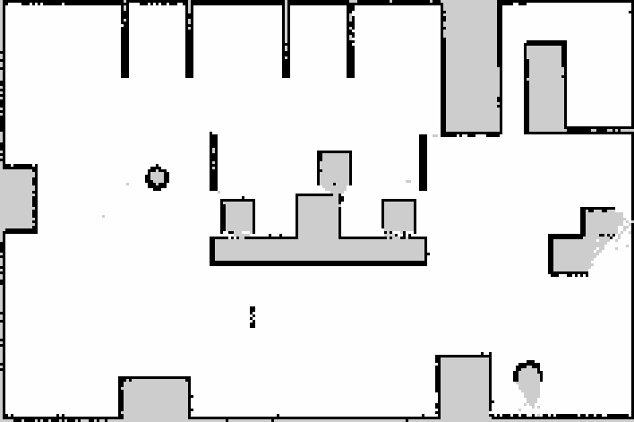

# Mini TP — Découverte de la navigation avec ROS 2 et Nav2

**Durée : 1 h 30.** Pas de code à écrire : on lance, on regarde, on manipule. Le but est de voir de ses propres yeux ce que présente le cours : RViz, l'odométrie et sa dérive, la cartographie (SLAM), la localisation et la navigation autonome.

Le robot est un **TurtleBot3 Waffle** simulé dans l'atelier fictif **MecaTri** (machines, convoyeur, étagères, palettes). Le simulateur est volontairement simple (vue de dessus, pas de 3D) : il produit exactement les messages d'un vrai robot (`/odom`, `/scan`, TF) et obéit à `/cmd_vel`.

| Partie | Thème | Durée |
|---|---|---|
| 0 | Préparation | 5 min |
| 1 | RViz et le robot | 15 min |
| 2 | L'odométrie, avec et sans glissement | 20 min |
| 3 | Faire une carte (SLAM) | 25 min |
| 4 | Naviguer avec Nav2 | 20 min |
| 5 | Bilan | 5 min |

---

## Partie 0 — Préparation (5 min)

Depuis le dossier du dépôt, compilez les deux workspaces (une seule fois) :

```
pixi run build
pixi run nav-build
```

Vous utiliserez **deux terminaux** :

- **Terminal A** : lance le robot, le simulateur et RViz avec `pixi run decouverte etape:=...`. On l'arrête avec **Ctrl+C** avant de passer à l'étape suivante.
- **Terminal B** : pour taper les commandes ROS 2. On l'ouvre avec `pixi run nav` et on le garde toute la séance.

> Fermez toujours le terminal A avec Ctrl+C avant de relancer : deux simulateurs en même temps donnent des comportements incompréhensibles.

---

## Partie 1 — RViz et le robot (15 min)

### Lancer

Terminal A :

```
pixi run decouverte etape:=odometrie derive:=false
```

RViz s'ouvre sur l'atelier vu de dessus. Le robot est en bas à gauche.

### Ce que montre RViz

Dans le panneau **Displays** à gauche, cochez et décochez chaque affichage pour voir ce qu'il apporte :

| Affichage | Ce que c'est | Topic ou source |
|---|---|---|
| Vraie salle (simulateur) | le plan de l'atelier, connu du simulateur seulement | `/simulateur/monde` |
| Robot | le modèle 3D du Waffle, construit à partir de l'URDF | `/robot_description` + TF |
| TF | les repères `map`, `odom`, `base_footprint`, `base_scan` | `/tf`, `/tf_static` |
| LaserScan | les points touchés par le lidar (360 rayons, 3,5 m) | `/scan` |
| Trace odométrique | les positions successives calculées par les roues | `/odom` |
| Pose vraie (simulateur) | où le robot est **réellement** (flèche magenta) | `/simulateur/pose_vraie` |

En haut du panneau, **Global Options → Fixed Frame** indique le repère dans lequel tout est dessiné. Passez-le de `map` à `base_footprint` : c'est maintenant le robot qui reste immobile et la salle qui bouge. Remettez `map`.

### Piloter le robot

Terminal B :

```
ros2 run teleop_twist_keyboard teleop_twist_keyboard
```

Le terminal B doit avoir le focus du clavier. Touches utiles :

| Touche | Effet |
|---|---|
| `i` / `,` | avancer / reculer |
| `j` / `l` | tourner à gauche / à droite sur place |
| `u` / `o` | avancer en tournant |
| `k` | s'arrêter |
| `z` | réduire les vitesses de 10 % (à faire 4 ou 5 fois au début) |

Faites un tour dans l'atelier. Observez le scan qui se cale sur les murs de la vraie salle, et la trace qui s'allonge. Le robot s'arrête s'il touche un obstacle.

Arrêtez la téléopération avec **Ctrl+C** dans le terminal B.

### Quelques commandes pour voir les coulisses

Terminal B :

```
ros2 node list
ros2 topic list
ros2 topic echo /cmd_vel
ros2 topic hz /scan
ros2 run tf2_ros tf2_echo odom base_footprint
```

`/cmd_vel` est la **seule** chose que le robot reçoit : une vitesse linéaire et une vitesse de rotation. Tout le reste (position, carte, chemin) est calculé à partir de ce qu'il renvoie.

---

## Partie 2 — L'odométrie, avec et sans glissement (20 min)

L'odométrie estime la position du robot en comptant les tours de roues. Elle ne voit rien : si une roue glisse, l'erreur s'accumule et ne se corrige jamais.

Dans cette étape, le repère `odom` est posé sur le point de départ. Donc **le robot, sa trace et son scan sont dessinés là où l'odométrie croit qu'il est**. La flèche magenta montre où il est vraiment.

### Sans glissement

Le simulateur est déjà lancé avec `derive:=false` (odométrie parfaite). Terminal B, faites faire au robot un carré de 2 m de côté :

```
ros2 run tb3_loopback_sim pilote --carre 2.0
```

Le robot revient à son point de départ. La trace est un carré fermé, la flèche magenta et le robot sont confondus, le scan reste collé aux murs.

### Avec glissement

Terminal A : Ctrl+C, puis

```
pixi run decouverte etape:=odometrie derive:=true
```

Le simulateur ajoute maintenant ce qui arrive sur un vrai robot : 2 % d'erreur sur les distances, 5 % sur les rotations, et un peu de bruit. Refaites le même carré :

```
ros2 run tb3_loopback_sim pilote --carre 2.0
```

**À observer :**

- la trace ne se referme plus : le robot « croit » être à 20 ou 30 cm de son point de départ ;
- la flèche magenta, elle, est bien revenue au départ : le robot a fait le bon trajet, c'est son estimation qui est fausse ;
- le scan ne colle plus aux murs de la vraie salle : il est dessiné depuis la position fausse ;
- l'erreur d'orientation est la plus grave : quelques degrés de travers au premier virage deviennent des dizaines de centimètres au bout du segment suivant.

Mesurez l'écart :

```
ros2 run tf2_ros tf2_echo map base_footprint
ros2 topic echo --once /simulateur/pose_vraie
```

Pilotez ensuite au clavier pendant deux ou trois minutes dans tout l'atelier, puis revenez au départ : l'écart grandit avec la distance parcourue.

**Ce qu'il faut retenir :** l'odométrie est précise à court terme et fausse à long terme. Pour se repérer sur la durée, le robot doit **comparer ce que voit son lidar à une carte**. C'est l'objet des deux parties suivantes.

---

## Partie 3 — Faire une carte (SLAM) (25 min)

SLAM signifie *Simultaneous Localization And Mapping* : le robot construit la carte et se localise dedans en même temps. Ici, c'est `slam_toolbox` qui compare chaque scan aux précédents pour corriger la dérive de l'odométrie.

### Lancer

Terminal A : Ctrl+C, puis

```
pixi run decouverte etape:=slam
```

Le glissement est actif : c'est le cas réaliste. La vraie salle n'est plus affichée : la seule carte est celle que le robot construit (gris = inconnu, blanc = libre, noir = obstacle).

### Cartographier

Terminal B :

```
ros2 run teleop_twist_keyboard teleop_twist_keyboard
```

Conseils pour une carte propre :

- roulez **lentement** (touche `z` plusieurs fois) et tournez sur place doucement ;
- longez les murs à environ un mètre ;
- passez par toutes les allées, entrez dans les deux alcôves du haut ;
- **revenez à votre point de départ** à la fin : c'est la fermeture de boucle, `slam_toolbox` reconnaît l'endroit et redresse toute la carte.

Comptez 10 à 15 minutes. Une carte réussie ressemble à ceci :



Pendant que vous roulez, regardez dans un autre onglet du terminal B la correction calculée par le SLAM :

```
ros2 run tf2_ros tf2_echo map odom
```

Au départ elle vaut zéro. Elle grandit au fil du trajet : c'est exactement la dérive de l'odométrie que le SLAM compense.

### Sauvegarder la carte

Sans arrêter le terminal A, dans le terminal B (qui est dans le dossier `nav_ws`) :

```
ros2 run nav2_map_server map_saver_cli -f ma_carte --ros-args -p save_map_timeout:=15.0
```

Deux fichiers apparaissent dans `nav_ws` : `ma_carte.pgm` (l'image) et `ma_carte.yaml` (résolution, origine). Ouvrez l'image pour la voir.

> Pas le temps de finir la carte ? Ce n'est pas grave : la partie 4 utilise par défaut une carte toute faite de l'atelier.

---

## Partie 4 — Naviguer avec Nav2 (20 min)

La carte est faite. Le robot doit maintenant **se localiser** dedans (AMCL, un filtre à particules) et **aller seul** là où on lui demande (Nav2 : planificateur global, contrôleur local, costmaps).

### Lancer

Terminal A : Ctrl+C, puis avec votre carte :

```
pixi run decouverte etape:=navigation carte:=ma_carte
```

ou avec la carte fournie :

```
pixi run decouverte etape:=navigation
```

Attendez une quinzaine de secondes que tous les nœuds de Nav2 démarrent.

### Se localiser

Le nuage vert de petites flèches est l'ensemble des hypothèses d'AMCL sur la position du robot (les particules).

1. Dans RViz, outil **2D Pose Estimate** (barre du haut) : cliquez où se trouve le robot et glissez dans la direction où il regarde. Faites-le volontairement un peu faux, à 30 cm près.
2. Terminal B, téléopérez le robot sur deux ou trois mètres. Le nuage se resserre, le scan rouge vient se caler sur les murs de la carte : AMCL a corrigé votre erreur.
3. Arrêtez la téléopération (Ctrl+C dans le terminal B).

### Envoyer le robot

1. Outil **Nav2 Goal** : cliquez une destination et glissez pour l'orientation finale.
2. Le robot calcule un chemin (ligne du **chemin global**), puis le suit en ajustant sa trajectoire en permanence (**chemin local**).
3. Les zones colorées autour des obstacles sont les **costmaps** : plus c'est foncé, plus le passage coûte cher. Le robot reste à distance des machines.

Destinations à essayer :

| Lieu | Position dans la carte (x, y) |
|---|---|
| Cellule de tri (convoyeur) | (5,0 ; 1,2) |
| Bac de rejet | (9,8 ; 0,8) |
| Retour au départ | (0 ; 0) |

Vous pouvez aussi envoyer un but en ligne de commande, comme le ferait un programme :

```
ros2 action send_goal /navigate_to_pose nav2_msgs/action/NavigateToPose "{pose: {header: {frame_id: map}, pose: {position: {x: 5.0, y: 1.2}, orientation: {w: 1.0}}}}"
```

### Un obstacle imprévu

Pendant que le robot roule, outil **Publish Point** : cliquez sur son chemin. Le simulateur y pose une palette de 40 cm, absente de la carte. Le lidar la voit, la costmap la marque, le chemin est recalculé et le robot la contourne.

Pour retirer toutes les palettes :

```
ros2 service call /simulateur/retirer_obstacle turtlesim/srv/Kill "{name: tous}"
```

### Pour aller un peu plus loin

- Envoyez un but **dans** une machine : Nav2 refuse, aucun chemin n'existe.
- Envoyez un but puis cliquez **Cancel** dans le panneau Navigation 2 : le robot s'arrête.
- Dans le panneau Navigation 2, mode **Waypoint** : cliquez plusieurs Nav2 Goal puis **Start Waypoint Following** pour une tournée.

---

## Partie 5 — Bilan (5 min)

| Brique | Ce qu'elle fait | Ce qu'elle publie |
|---|---|---|
| Robot (ici le simulateur) | obéit à `/cmd_vel`, mesure ses roues et son lidar | `/odom`, `/scan`, TF `odom → base_footprint` |
| `robot_state_publisher` | publie la géométrie du robot (URDF) | TF `base_footprint → base_link → base_scan` |
| SLAM (`slam_toolbox`) | construit la carte et corrige la dérive | `/map`, TF `map → odom` |
| AMCL | se localise sur une carte connue | TF `map → odom`, `/particle_cloud` |
| Nav2 | planifie un chemin et le suit | `/plan`, `/cmd_vel` |

Les trois idées à retenir :

1. **L'odométrie dérive** : seule, elle ne permet pas de se repérer longtemps.
2. **Le lidar comparé à une carte corrige la dérive** : c'est le rôle du SLAM pendant la cartographie, puis d'AMCL pendant la navigation. Les deux publient la même chose, la transformation `map → odom`.
3. **Nav2 ne fait que produire des vitesses** : un chemin sur une carte, suivi par un contrôleur qui envoie `/cmd_vel`. Si la localisation est fausse, la navigation l'est aussi.

---

## En cas de problème

- **RViz affiche « Fixed Frame [map] does not exist »** à l'étape navigation : attendez 15 s ; sinon donnez une pose avec 2D Pose Estimate.
- **Rien ne bouge avec le clavier** : le terminal de téléopération doit avoir le focus ; vérifiez `ros2 topic echo /cmd_vel`.
- **Le robot « saute » ou deux robots semblent se battre** : un ancien lancement tourne encore. Ctrl+C partout, `ros2 node list` doit être vide, puis relancez.
- **Messages `RTPS_TRANSPORT_SHM Error`** : fermez tous les terminaux et rouvrez-les (l'environnement pixi désactive ce transport, mais seulement dans les terminaux ouverts après l'installation).
- **`Carte introuvable`** : vérifiez le nom passé à `carte:=` ; la carte doit être dans `nav_ws` (ou donnez le chemin complet).
