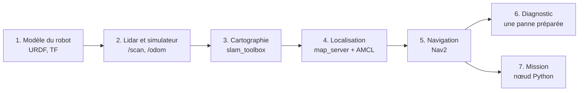
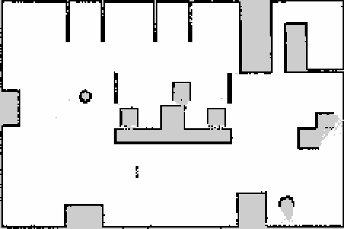

# TP ROS 2 — Le TurtleBot3 livreur : navigation autonome avec Nav2

**Durée :** 6 h 30   **Prérequis :** TP « tortue livreuse », module 4 du cours (Nav2), environnement Pixi installé (voir le [README](../README.md) du dépôt)

Dans ce TP, vous construisez **couche par couche** la pile logicielle qui permet à un TurtleBot3 Burger d'aller seul d'un point à un autre dans un atelier : le modèle du robot, le lidar, la carte, la localisation, puis la navigation. Le code est fourni ; vous complétez les endroits marqués `>>> À COMPLÉTER` et vous répondez aux questions.

> **Comment lire ce TP.** Chaque étape commence par une **question** (Q1, Q2…) posée *avant* la manipulation, réfléchissez y avant de faire la suite. Les **pistes** sont des choses à essayer pour vérifier par vous-même, *avant* de lire la suite. La rubrique **à retenir** donne ensuite la réponse en quelques lignes. 

## Objectifs

À la fin du TP, vous saurez expliquer et manipuler :

| Notion | Où la voit-on dans le TP ? |
|---|---|
| **Modèle du robot (URDF, xacro)** | `burger.urdf.xacro`, `robot_state_publisher`, `/joint_states`, `/tf_static` |
| **Repères et TF** | `map → odom → base_footprint → base_link → base_scan`, `tf2_echo`, `view_frames` |
| **Capteur et contrat de message** | `sensor_msgs/LaserScan` : `frame_id`, `angle_min`, `ranges`, `inf` |
| **Odométrie et dérive** | `/odom`, le carré qui ne se referme pas |
| **Cartographie (SLAM)** | `slam_toolbox`, `/map`, la carte sauvegardée (PGM + YAML) |
| **Localisation (AMCL)** | `map_server`, `amcl`, particules, pose initiale, robot kidnappé |
| **Nœuds à cycle de vie** | `lifecycle_manager`, `ros2 lifecycle get` |
| **Navigation (Nav2)** | costmaps, inflation, planificateur, contrôleur, l'action `/navigate_to_pose` |
| **Diagnostic** | une panne préparée, une variable modifiée, une commande qui tranche |

## Le scénario

L'atelier fictif **MecaTri** (celui du cas client du cours) trie des pièces dans une cellule robotisée. Le TurtleBot3 Burger est chargé d'amener les bacs A, B et Rejet de la cellule vers trois postes de l'atelier. Pour cela il doit : connaître sa propre géométrie, voir les murs avec son lidar, **construire la carte** de l'atelier, **se localiser** dedans, puis **planifier et suivre** un chemin en évitant les obstacles, y compris ceux qui n'étaient pas là quand la carte a été faite.



### Le fil rouge : qui publie chaque transformation ?

Gardez ce tableau sous la main et remplissez-le au fil du TP. C'est la question centrale de la navigation.

| Transformation | Publiée par | Partie |
|---|---|---|
| `base_footprint → base_link`, roues, `base_scan` | | 1 |
| `odom → base_footprint` | | 2 |
| `map → odom` pendant la cartographie | | 3 |
| `map → odom` pendant la navigation | | 4 |

> **Rappel PowerShell** : chaque nouveau terminal doit être préparé avec la commande `pixi run nav` depuis `ros2_ws`. Si vous faites des modifications dans le code `pixi run nav-build` depuis `ros2_ws` pour installer le code.

---

## Partie 0 — Mise en route (15 min)

Ouvrez un terminal dans `ros2_ws`, puis :

```powershell
pixi run nav-build
pixi run nav
ros2 pkg list | Select-String tb3
```

Le workspace contient deux packages :

- `tb3_loopback_sim` : le simulateur (fourni, à lire, pas à modifier) ;
- `tb3_livreur` : **votre** package : `urdf/`, `launch/`, `config/`, `rviz/`, `maps/` et le nœud `mission.py`.

Regardez l'arborescence de `nav_ws/src/tb3_livreur` et repérez les fichiers que vous allez compléter : `urdf/burger.urdf.xacro`, `config/slam.yaml`, `config/amcl.yaml`, `config/nav2.yaml`, les cinq launch files et `tb3_livreur/mission.py`.

---

## Partie 1 — Le modèle du robot (45 min)

Un robot est d'abord un **arbre de repères** : chaque pièce (lien, *link*) est reliée à son parent par une articulation (*joint*) fixe ou mobile. Le fichier URDF décrit cet arbre ; `robot_state_publisher` le lit et publie les transformations TF.

### 1.1 Un modèle sans articulation mobile

**Q1 — Avant de lancer.** Le fichier `burger.urdf.xacro` décrit la géométrie des roues. Est-ce que celà permet de connaître l'angle *actuel* d'une roue ? D'où devra venir cette information ?

**Pistes.** Ouvrez `urdf/burger.urdf.xacro` : cherchez les joints de type `continuous` et `fixed`. Puis, dans deux terminaux préparés :

```powershell
ros2 launch tb3_livreur 1_modele.launch.py gui:=false
```

```powershell
ros2 topic list
ros2 node info /robot_state_publisher
```

Dans RViz, le modèle s'affiche-t-il entièrement ? Regardez le panneau *Displays* > *RobotModel* > *Status*.

**Manipulation.** Arrêtez (Ctrl+C) puis relancez avec les curseurs :

```powershell
ros2 launch tb3_livreur 1_modele.launch.py
```

Une petite fenêtre « Joint State Publisher » apparaît. Bougez les curseurs. Puis dans un autre terminal :

```powershell
ros2 topic echo /joint_states --once
ros2 topic hz /tf
ros2 topic echo /tf_static --once
```

**À retenir.** L'URDF ne contient que la **structure** du robot. Pour les articulations mobiles, `robot_state_publisher` a besoin d'un **état articulaire** (`/joint_states`), fourni ici par les curseurs, sur le vrai robot par les encodeurs (via `turtlebot3_node`), en simulation par le simulateur. Les transformations des joints **fixes** sont publiées une seule fois sur `/tf_static` ; celles des joints **mobiles** en continu sur `/tf`.

### 1.2 Compléter le modèle

**Q2 — Avant de modifier.** Le modèle fourni n'a qu'une roue. Dans le repère du robot (x vers l'avant, y vers la gauche), quel est le signe de la coordonnée y de la roue droite ? L'entraxe du Burger est de 0,160 m : quelle valeur mettre ?

**Manipulation.** Dans `burger.urdf.xacro`, repérez la macro `roue` et son appel pour la roue gauche. Complétez :

1. l'appel de la macro pour la **roue droite** (`>>> À COMPLÉTER 1`) ;
2. l'origine de la **roulette arrière** `caster_back_joint` (`>>> À COMPLÉTER 2`), 81 mm derrière le centre du châssis, 4 mm sous `base_link`.

Reconstruisez (`pixi run nav-build` puis pixi run nav), relancez `1_modele.launch.py` : les deux roues doivent apparaître et tourner avec les curseurs.

**Q3 — Avant d'essayer.** Si l'on inverse `parent` et `child` dans un joint, que se passe-t-il ? Prédisez, essayez sur le joint de la roulette, observez le terminal de `robot_state_publisher` et RViz, puis remettez en ordre.

**À retenir.** Un URDF est un **arbre** : chaque lien a exactement un parent, et le lien racine (`base_footprint`) n'en a pas. Si il y a deux parents pour un lien, ou un cycle (un enfant qui est a une chemin qui ramène a son parent), et `robot_state_publisher` refuse le modèle.

### 1.3 Deux repères pour une base

**Q4 — Avant de regarder.** Pourquoi le modèle a-t-il deux repères : `base_footprint` et `base_link` ? Lequel est au niveau du sol ?

**Pistes.**

```powershell
ros2 run tf2_ros tf2_echo base_footprint base_link
ros2 run tf2_tools view_frames       # produit frames_xxx.pdf dans le dossier courant
```

Ouvrez le PDF : c'est le premier arbre TF du TP. Gardez-le, vous le comparerez à celui de la fin.

**À retenir.** `base_footprint` est la projection du robot **au sol** (z = 0) : c'est le repère que Nav2 et AMCL utilisent pour la navigation. `base_link` est le châssis, le lieu où sont executé les vitesses, 1 cm plus haut. Les capteurs sont attachés à `base_link`.

**Point de contrôle 1.** Le Burger complet dans RViz (châssis, deux roues, roulette, lidar bleu), roues qui tournent avec les curseurs, `view_frames` avec 7 repères.

*Pour comparer : le modèle officiel ROBOTIS, avec ses maillages 3D, est dans le package `turtlebot3_description` : `ros2 launch tb3_livreur 1_modele.launch.py urdf:=$(ros2 pkg prefix turtlebot3_description)/share/turtlebot3_description/urdf/turtlebot3_burger.urdf` — même structure, mêmes noms de repères.*

---

## Partie 2 — Le lidar, le simulateur, l'odométrie (45 min)

Un capteur est une **donnée** (`sensor_msgs/LaserScan`) **exprimée dans un repère** (`header.frame_id`). Si le repère est faux (mal positionné) alors tout ce qui suit est faux.

### 2.1 Le repère du lidar

**Q5 — Avant de lancer.** D'après ce que vous avez vu dans le cours, as t'on absolument besoin de la doc pour savoir le nombre de rayons qu'à un lidar (aide : souvenez vous du contenue du message LaserScan)? Dans un message `LaserScan`, que signifie une valeur `inf` dans `ranges` ?

**Manipulation.** Le lien `base_scan` existe dans l'URDF mais son joint est incomplet (`>>> À COMPLÉTER 3`) : le lidar est posé 32 mm derrière le centre du châssis et 172 mm au-dessus de `base_link` (xyz = `-0.032 0 0.172`). Complétez, reconstruisez, puis lancez le robot complet :

```powershell
  ros2 launch tb3_livreur 2_robot.launch.py
```

RViz s'ouvre avec le modèle, l'odométrie et le scan (points rouges). Dans un autre terminal :

```powershell
ros2 interface show sensor_msgs/msg/LaserScan
ros2 topic echo /scan --once --no-arr
ros2 run tf2_ros tf2_echo base_footprint base_scan
```

**Pistes.** Regarder le contenue : `angle_min`, `angle_increment`, `range_max` et `frame_id`. Combien de valeurs dans `ranges` ? 

**À retenir.** Notre lidar à 360 rayons, un par degré, de 0,12 à 3,5 m. `inf` : rien touché avant `range_max`. Le `frame_id` est `base_scan` : les distances sont mesurées **depuis l'origine de ce repère**, l'angle 0 est **son** axe x. C'est TF qui permet de replacer ces points dans n'importe quel autre repère.

### 2.2 Le lidar à l'envers

**Q6 — Avant de modifier.** Si l'on tourne le lidar de 180° dans l'URDF, sans toucher au capteur, que devient l'affichage du scan dans RViz ? Les données du message `/scan` changent-elles ? 


**Pistes.** Le joint `scan_joint` a un argument `scan_yaw`. Relancez avec `scan_yaw:=3.14159` :

```powershell
ros2 launch tb3_livreur 2_robot.launch.py scan_yaw:=3.14159
```

Comparez `ros2 topic echo /scan --once --no-arr` avant et après ; regardez `tf2_echo base_link base_scan`.

**Manipulation.** Téléopérez le robot vers un mur avec le clavier, dans un terminal préparé **qui a le focus** (cliquer dans le terminal):

```powershell
ros2 run teleop_twist_keyboard teleop_twist_keyboard
```

Le mur apparaît derrière le robot au lieu de devant. Remettez `scan_yaw:=0.0`.

**À retenir.** Le message est **identique** : mêmes distances, mêmes angles. Seule la transformation `base_link → base_scan` a changé, donc RViz (et plus tard AMCL et Nav2) placent les mêmes points ailleurs. Sur un vrai robot, un lidar monté à l'envers se corrige **dans l'URDF**, pas dans le driver. C'est le premier cas du mini-cas de diagnostic du cours.

### 2.3 L'odométrie

**Q7 — Avant de regarder.** L'URDF de la partie 1 ne contient pas de repère `odom`. `robot_state_publisher` peut-il publier `odom → base_footprint` ? Sinon, qui le peut, et à partir de quelles informations ? Sur le vrai robot, qui le ferait ?

**Pistes.**

```powershell
ros2 topic info /tf -v          # deux publieurs : lesquels ?
ros2 node info /simulateur      # ce qu'il reçoit, ce qu'il publie
```

**Manipulation.** RViz dessine tout dans un seul repère, le *Fixed Frame* (*Displays* > *Global Options*) : c'est lui qui reste immobile à l'écran. Pendant la téléopération, essayez `base_footprint` (le robot reste au centre et les murs du scan défilent), puis `odom` (le robot se déplace et les murs restent en place). Gardez `odom` pour la suite.

**À retenir.** Deux sources de TF : `robot_state_publisher` publie l'**intérieur** du robot (l'URDF, plus `/joint_states` pour les roues) ; l'odométrie publie **où est le robot** (`odom → base_footprint`) à partir des vitesses des roues : ici le simulateur, sur le vrai robot `turtlebot3_node`. Remplissez la ligne 2 du tableau TF.

**Q8 — Avant de tourner.** Si le robot fait exactement un tour sur lui-même, l'odométrie dira-t-elle qu'il a tourné de 360° ? Comment le vérifier sans connaître la vraie position du robot ?

**Manipulation.** *Fixed Frame* = `odom`. Dans *Displays* > *LaserScan*, réglez *Decay Time* à `60` : RViz garde les scans de la dernière minute, chacun placé là où l'odométrie dit que le robot était. Dans un autre terminal, lancez `ros2 run tf2_ros tf2_echo odom base_footprint` : le yaw est le dernier nombre de la ligne `Rotation: in RPY (degree)`. Ralentissez la rotation (touche `c` de la téléopération, plusieurs fois), puis faites tourner le robot sur place (`j`) jusqu'à ce que, **d'après l'odométrie**, il ait fait exactement un tour : le yaw repasse par 0 et le modèle dans RViz pointe de nouveau dans sa direction de départ. Arrêtez (`k`). Les murs vus maintenant se superposent-ils à ceux du début ?

Recommencez avec une odométrie parfaite :

```powershell
ros2 launch tb3_livreur 2_robot.launch.py derive:=false
```

*Pour aller plus loin : même manipulation avec un carré d'environ 2 m de côté. Les murs se dédoublent aussi, mais l'effet est moins net qu'avec la rotation.*

**À retenir.** L'odométrie est une **intégration** des vitesses mesurées (ici : commandées, avec une erreur d'échelle et du bruit, comme des encodeurs sur un sol qui glisse). Elle est **continue** et précise à court terme, mais l'erreur **s'accumule** : ici, quand l'odométrie compte un tour, le robot n'a réellement tourné que d'environ 343°, et au bout de quelques mètres `odom` ne dit plus où est le robot dans la salle. Sans carte, le seul moyen de voir cette dérive est de **comparer ce que voit le capteur** à ce que dit l'odométrie : les murs, fixes en réalité, se décalent dans le repère `odom`. C'est exactement ce que fera le SLAM en partie 3.

**Point de contrôle 2.** `tf2_echo base_footprint base_scan` donne la translation `[-0.032, 0.000, 0.182]` ; scan visible ; après un tour « odométrique », les murs vus à la fin sont tournés d'environ 17° par rapport à ceux du début (ils se superposent avec `derive:=false`).

---

## Partie 3 — Cartographier en téléopérant (40 min)

`slam_toolbox` construit la carte **en même temps** qu'il estime la pose du robot (SLAM). Il lit `/scan` et TF (`odom → base_footprint → base_scan`), publie `/map` et la transformation `map → odom`.

### 3.1 Configurer et lancer

**Q9 — Avant de lancer.** Pourquoi ne suffit-il pas de coller tous les scans les uns après les autres en utilisant l'odométrie ? Qu'obtiendrait-on avec l'odométrie dérivante de la partie 2 ?

**Manipulation.** Complétez `config/slam.yaml` (`>>> À COMPLÉTER 4` : repères, topic, mode, portée du lidar) et `launch/3_slam.launch.py` (`>>> À COMPLÉTER 5` : le nœud `async_slam_toolbox_node` du package `slam_toolbox`). Reconstruisez, puis :

```powershell
ros2 launch tb3_livreur 3_slam.launch.py
```

```powershell
ros2 run teleop_twist_keyboard teleop_twist_keyboard
```

**Pistes.** Avant de cartographier, regardez avec `ros2 run tf2_ros tf2_echo map odom` ce que vaut `map → odom` au départ, puis après quelques mètres. Regardez `view_frames` : qui publie `map → odom` ? Remplissez la ligne 3 du tableau.

Cartographiez tout l'atelier. Conseils : **lentement** (vitesse 0,15 m/s), tournez puis avancez plutôt que les deux à la fois, ne collez pas les murs, et **fermez les boucles** en repassant par des endroits déjà vus. Les deux alcôves du haut et le couloir étroit en haut à droite font partie de l'atelier.

**À retenir.** Avec l'odométrie seule, la dérive ferait apparaître des murs dédoublés et des pièces déformées. slam_toolbox **recale** chaque scan sur les précédents (scan matching) et, quand le robot revient dans un lieu connu, corrige d'un coup toute la trajectoire (fermeture de boucle). La correction est portée par `map → odom` : l'odométrie reste continue, c'est `map → odom` qui « saute ».

### 3.2 La grille d'occupation

**Q10 — Avant d'ouvrir.** Dans l'image qui va être sauvegardée, quelles couleurs de pixel représentent un espace libre, occupé, inconnu ? Que représente l'`origine` du carte ? Quelle taille fait l'atelier ? Quelle taille fera l'image.

**Manipulation.** Aller dans le dossier `nav_ws/src/tb3_livreur` via la commande cd (le délai de 15 s laisse le temps à `map_saver` de recevoir la carte, publiée toutes les 2 s) :

```powershell
ros2 run nav2_map_server map_saver_cli -f maps/atelier --ros-args -p save_map_timeout:=15.0
```

Deux fichiers : `maps/atelier.pgm` et `maps/atelier.yaml`. Ouvrez le YAML dans VS Code et le PGM dans un éditeur d'images (Paint ou GIMP suffisent). Comparez avec `ros2 topic echo /map --once --no-arr` (champ `info`).

**Pistes.** Mesurez la largeur de l'image en pixels et multipliez par `resolution`. Repérez la **table** près du départ : le lidar n'en voit que les pieds. Que verra Nav2 ?

**Manipulation.** Retouchez la carte sur GIMP (ou autre éditeur de PGM) si vous voulez: effacez un artefact s'il y en a, et **dessinez en noir** le rectangle de la table (ce que le lidar ne voit pas mais que le robot ne doit pas traverser). Enregistrez en PGM, puis reconstruisez (`colcon build`) pour que la carte soit installée.

**À retenir.** La carte est une image en niveaux de gris : 0 = occupé (noir), 254 = libre (blanc), 205 = inconnu (gris) ; `origin` est la position, dans le repère `map`, du coin **bas-gauche** de l'image. La carte est un **fichier image comme un autre** : on peut la corriger à la main pour interdire une zone ou corriger des défauts.

**Point de contrôle 3.** `maps/atelier.pgm` fermé (pas de mur ouvert), les quatre zones (cellule, alcôves, couloir, machines) visibles, table dessinée. *En cas de problème, une carte de secours est fournie : `maps/atelier_secours.yaml`.* Une carte complète ressemble à ceci (avant retouche, les étagères et les machines ne sont vues que par leurs faces) :



---

## Partie 4 — Se localiser (50 min)

La carte est faite. On arrête le SLAM et on le remplace par **AMCL** (Adaptive Monte Carlo Localization) : un algorithme particulaire qui compare le scan à la carte pour estimer la pose du robot.

### 4.1 Deux autorités pour une transformation

**Q11 — Avant de lancer.** Peut-on lancer SLAM et AMCL en même temps ? Que se passerait-il sur `map → odom` ?

**Pistes.** Lancez `3_slam.launch.py` et, dans un autre terminal, `4_localisation.launch.py` (ci-dessous). Regardez `view_frames` et `tf2_echo map odom` pendant quelques secondes. Arrêtez ensuite le SLAM **pour de bon**.

**Manipulation.** Complétez `config/amcl.yaml` (`>>> À COMPLÉTER 6` : repères, topic, portée du lidar, nombre de particules, seuils de mise à jour) et `launch/4_localisation.launch.py` (`>>> À COMPLÉTER 7` : la liste `node_names` du lifecycle manager). Reconstruisez, puis :

```powershell
ros2 launch tb3_livreur 4_localisation.launch.py
```

Dans RViz : outil **2D Pose Estimate** (barre du haut), cliquez à la position du robot et glissez dans sa direction. Le robot démarre en (0, 0) orienté vers +x : le coin bas-gauche de la carte.

**À retenir.** Une transformation TF a **un seul** publieur. SLAM pendant la cartographie, AMCL pendant la navigation sur carte fixe : jamais les deux.

### 4.2 Les nœuds à cycle de vie

**Q12 — Avant de regarder.** `amcl` apparaît dans `ros2 node list`. Est-il pour autant prêt à travailler ? Qu'est-ce qui le rend actif ?

**Pistes.**

```powershell
ros2 lifecycle get /amcl
ros2 lifecycle get /map_server
ros2 node info /lifecycle_manager_localisation
```

Puis relancez avec `amcl_gere:=false` et refaites `ros2 lifecycle get /amcl`. Y a-t-il encore une transformation `map → odom` ?

**À retenir.** Les nœuds Nav2 sont des **nœuds à cycle de vie** : `unconfigured → inactive → active`. Un nœud présent mais inactif ne publie rien. Le `lifecycle_manager` les fait passer dans l'ordre par `configure` puis `activate`. Oublier un nœud dans `node_names`, c'est le laisser inactif.

### 4.3 Les particules

**Q13 — Avant de bouger.** Après la pose initiale, les particules (flèches vertes) forment un nuage. Faut-il bouger pour qu'il se resserre ? Pourquoi ?

**Pistes.** Donnez la pose initiale, attendez 30 s sans rien faire. Puis téléopérez lentement vers un coin de mur ou une machine. Comparez le scan (rouge) et les murs de la carte (noir) : se superposent-ils ?

**Manipulation.** Dans `amcl.yaml`, mettez `max_particles: 50`, relancez, redonnez la pose initiale ; puis `5000`. Observez la convergence et le temps de calcul (`ros2 topic hz /particle_cloud`). Remettez 2000.

**À retenir.** Chaque particule est une pose possible (x, y, θ). AMCL **prédit** avec l'odométrie puis **pondère** avec le scan : il faut du mouvement et des murs vus sous différents angles pour départager les hypothèses. Trop peu de particules : on peut rater la bonne pose ; trop : du calcul pour rien.

### 4.4 L'ambiguïté et le robot kidnappé

**Q14 — Avant d'essayer.** Le robot est posé dans une des deux alcôves identiques, pose initiale inconnue. AMCL peut-il trancher sans bouger ? Et en sortant de l'alcôve ?

**Manipulation.** Téléportez le robot (le simulateur seul, AMCL n'est pas prévenu) dans l'alcôve de gauche, puis demandez une localisation **globale** :

```powershell
ros2 topic pub --once /simulateur/teleporter geometry_msgs/msg/PoseWithCovarianceStamped "{header: {frame_id: map}, pose: {pose: {position: {x: 2.0, y: 6.2}, orientation: {z: 0.707, w: 0.707}}}}"
ros2 service call /reinitialize_global_localization std_srvs/srv/Empty
```

Téléopérez d'abord **sans sortir** de l'alcôve, puis sortez vers la cellule. Observez le nuage.

**Q15 — Avant d'essayer.** Robot kidnappé : on le déplace sans prévenir AMCL (téléportation en `x: 9.8, y: 0.8`). Quelle information devient trompeuse ? Comment s'en remettre ?

**Pistes.** Après la téléportation, regardez le scan par rapport à la carte, puis `/amcl_pose`. Essayez : téléoper un peu ; relocalisation globale ; nouvelle pose initiale dans RViz. Qu'est-ce qui marche le plus vite ?

**À retenir.** Deux lieux identiques donnent le **même scan** : il faut une observation distinctive (sortir, voir un détail) pour lever l'ambiguïté. Un robot déplacé garde une estimation fausse et une odométrie qui prédit depuis cette estimation fausse : il faut **détecter** l'incohérence scan/carte et **réinitialiser** (pose initiale ou localisation globale). Une concentration de particules n'est pas une preuve de vérité.

**Point de contrôle 4.** Scan superposé aux murs de la carte pendant la téléop ; `tf2_echo map base_footprint` suit le robot ; lignes 3 et 4 du tableau remplies ; `ros2 node info /amcl` montre `/scan`, `/map`, `/initialpose` en entrée et `/amcl_pose`, `/particle_cloud`, `/tf` en sortie.

---

## Partie 5 — Naviguer avec Nav2 (75 min)

Nav2 est un ensemble de **serveurs** spécialisés, coordonnés par un behavior tree : le `planner_server` calcule un chemin sur la **costmap globale**, le `controller_server` le suit en produisant des vitesses à partir de la **costmap locale**, le `behavior_server` tente des reprises en cas de blocage, et le `bt_navigator` expose tout cela comme **une action** : `/navigate_to_pose`.

### 5.1 Configurer le robot

**Q16 — Avant de remplir.** Le Burger fait 138 mm de large et 178 mm de long. Quel rayon pour le cercle qui l'englobe ? Quelle marge ajouter ? Ses vitesses maximales sont 0,22 m/s et 2,84 rad/s. Et dans quel repère est la costmap locale, et pourquoi pas `map` ?

**Manipulation.** Ouvrez `config/nav2.yaml` et complétez les `>>> À COMPLÉTER 8` : `robot_radius` (deux costmaps), `inflation_radius` (deux costmaps), vitesses maximales (contrôleur et `velocity_smoother`), repères (`global_frame`, `robot_base_frame`), le topic de la source d'observation `scan`, et les tolérances d'arrivée. Chaque valeur doit être **justifiée** en une ligne dans vos réponses.

Complétez `launch/5_navigation.launch.py` (`>>> À COMPLÉTER 9` : la liste des sept serveurs gérés par le lifecycle manager). Reconstruisez, puis :

```powershell
ros2 launch tb3_livreur 5_navigation.launch.py
```

Tant que la pose initiale n'est pas donnée, le terminal répète `Timed out waiting for transform from base_footprint to map` : la costmap globale attend `map → odom`, donc AMCL, donc vous. Dans RViz : **2D Pose Estimate**, puis **Nav2 Goal** (ou l'outil *2D Goal Pose*) vers la cellule de tri (au centre, devant le convoyeur). Le robot y va.

**À retenir.** Demi-diagonale du châssis : √(0,069² + 0,089²) ≈ 0,113 m, soit `robot_radius: 0.12`. La costmap locale est dans `odom` : un repère **continu**, sans les sauts de `map → odom`, pour que le contrôleur ne voie pas les obstacles bouger quand AMCL corrige.

### 5.2 Deux costmaps

**Q17 — Avant de regarder.** Pourquoi deux costmaps ? Laquelle est « roulante » (elle suit le robot) ? Que contient chacune ?

**Pistes.** Dans RViz, décochez puis recochez *Costmap globale* et *Costmap locale* pendant un déplacement. Puis :

```powershell
ros2 param get /local_costmap/local_costmap rolling_window
ros2 param get /local_costmap/local_costmap plugins
ros2 param get /global_costmap/global_costmap plugins
```

**À retenir.** La **globale** couvre toute la carte (couche statique + obstacles observés + inflation) et sert au planificateur. La **locale** est une fenêtre de 3 m × 3 m autour du robot (obstacles observés + inflation), mise à jour plus vite, pour le contrôleur. Les coûts internes vont de 0 (libre) à 254 (létal) ; 253 marque la zone où le centre du robot ne peut pas aller.

### 5.3 Inflation et passage étroit

**Q18 — Avant de changer.** Le couloir entre les deux étagères (en haut à droite) fait 0,70 m dans l'atelier, et moins sur votre carte (les murs y font une cellule de plus de chaque côté, et le scan en direct ajoute encore les siens). Le robot passera-t-il avec `inflation_radius: 0.35` ? Avec `0.15` ? Et si `robot_radius` passait à 0,40 ? Quelle est la différence entre un **coût** et une cellule **létale** ?

**Manipulation.** Envoyez un but au **poste B** (derrière le couloir, en haut à droite). Observez le chemin et la couleur du couloir dans la costmap globale. Puis, **à chaud** :

```powershell
ros2 param set /global_costmap/global_costmap inflation_layer.inflation_radius 0.15
ros2 param set /global_costmap/global_costmap inflation_layer.inflation_radius 1.0
ros2 param set /global_costmap/global_costmap robot_radius 0.40
```

Renvoyez le même but après chaque changement. Remettez les valeurs d'origine.

**À retenir.** `robot_radius` fixe la zone **létale** (le centre du robot ne peut pas s'approcher d'un mur à moins de ce rayon) : à 0,40 m, un couloir de 0,70 m est infranchissable. `inflation_radius` ajoute un **coût décroissant** autour : le planificateur préfère passer loin des murs, mais un couloir cher reste franchissable. L'inflation est une préférence, le rayon est une contrainte.

### 5.4 Ce qui est recalculé en continu

**Q19 — Avant de mesurer.** `/plan` (chemin global) et `/local_plan` (trajectoire du contrôleur) : lequel est recalculé le plus souvent, et pourquoi ?

**Pistes.** Pendant un déplacement : `ros2 topic hz /plan` puis `ros2 topic hz /local_plan`. Regardez `controller_frequency` dans `nav2.yaml` et la fréquence de replanification dans le behavior tree par défaut (le cours : *PipelineSequence*, `RateController`).

**À retenir.** Le chemin global est recalculé **environ une fois par seconde** par le BT ; le contrôleur produit une commande **20 fois par seconde**. Nav2 n'est pas une cascade exécutée une fois : la boucle replanifie pendant tout le déplacement.

### 5.5 Un obstacle qui n'était pas sur la carte

**Q20 — Avant de poser.** On pose une palette sur le chemin du robot, après avoir fait la carte. Quelle couche de costmap va la voir ? Le chemin sera-t-il recalculé ? Et quand on la retire ?

**Manipulation.** Lancez un but vers le poste A (en haut à gauche), puis posez une palette sur le trajet (coordonnées à adapter à votre chemin, 40 cm de côté) :

```powershell
ros2 service call /simulateur/ajouter_obstacle turtlesim/srv/Spawn "{x: 0.5, y: 3.5, name: palette}"
```

Observez le scan, les costmaps, le chemin. Puis retirez-la :

```powershell
ros2 service call /simulateur/retirer_obstacle turtlesim/srv/Kill "{name: palette}"
```

**Pistes.** La palette disparaît-elle immédiatement de la costmap locale ? De la globale ? Cherchez `clearing` et `marking` dans `nav2.yaml`.

**À retenir.** La couche **obstacle** marque les impacts du lidar (*marking*) et libère les cellules traversées par les rayons (*clearing*). Elle complète la couche **statique** (la carte). Sans elle, le robot foncerait dans tout ce qui n'était pas là le jour de la cartographie.

### 5.6 L'action de navigation

**Q21 — Avant d'envoyer.** Un but dans un mur, ou dans une zone inconnue : que répond Nav2 ? Et si on annule une navigation en cours, le robot s'arrête-t-il **vraiment** ?

**Manipulation.** Envoyez un but dans la cellule de tri (un mur), lisez les sorties de `planner_server` et `bt_navigator`. Puis, à la main, avec retour d'avancement :

```powershell
ros2 action list -t
ros2 action send_goal /navigate_to_pose nav2_msgs/action/NavigateToPose "{pose: {header: {frame_id: map}, pose: {position: {x: 0.2, y: 6.0}, orientation: {w: 1.0}}}}" --feedback
```

Pendant le déplacement, Ctrl+C dans ce terminal (annulation). Vérifiez avec `ros2 topic echo /cmd_vel` et RViz que le robot s'arrête.

**À retenir.** Nav2 ne fait que des **actions** : but, feedback (distance restante, nombre de reprises), résultat, annulation. C'est la même mécanique que `RotateAbsolute` au TP 1. Un but inatteignable est **refusé** par le planificateur ; le BT tente des reprises puis échoue. L'annulation est confirmée par l'action, mais c'est la chaîne de commande (`velocity_smoother` → `/cmd_vel` → robot) qui impose réellement la vitesse nulle.

**Point de contrôle 5.** Un but atteint vers chacun des trois postes ; la palette contournée ; le couloir refusé avec `robot_radius: 0.40`.

---

## Partie 6 — Diagnostiquer une panne (35 min)

Une seule variable a été modifiée dans la chaîne. Vous ne savez pas laquelle. Vous travaillez **par couches** (le cours, « diagnostiquer par couches ») : base, TF et temps, localisation et costmaps, actions. Pour chaque panne, remplissez une fiche :

| Symptôme observé | Hypothèse | Commande d'observation | Verdict | Correction |
|---|---|---|---|---|
| | | | | |

```powershell
ros2 launch tb3_livreur 5_navigation.launch.py panne:=1
```

Faites de même pour `panne:=2`, `panne:=3` et, si vous avez le temps, `panne:=4`. Donnez la pose initiale, envoyez un but, observez. Commandes utiles : `ros2 topic list`, `ros2 topic info <topic> -v`, `ros2 lifecycle get <nœud>`, `ros2 run tf2_tools view_frames`, `ros2 run tf2_ros tf2_echo`, `ros2 topic echo --once`.

**Q22.** Pour chaque panne : quelle est la variable modifiée, quelle commande l'a prouvé, et où faudrait-il la corriger (URDF, YAML, launch) ?

**À retenir.** Ne changez pas le planificateur parce que le robot ne bouge pas. Vérifiez d'abord que le but est accepté, que les nœuds sont actifs, que les données arrivent (publieurs **et** abonnés sur le bon topic, bons repères), puis seulement les réglages.

---

## Partie 7 — Mission autonome (30 min)

Le TP 1 donnait un **nom de lieu** à la tortue. On fait la même chose, mais avec un vrai planificateur : `mission.py` utilise `nav2_simple_commander`, un client Python de l'action `/navigate_to_pose`.

**Q23 — Avant de lire.** Entre un topic de coordonnées et l'action `NavigateToPose`, qu'apporte l'action à une mission qui dure trente secondes ?

**Pistes.** `ros2 interface show nav2_msgs/action/NavigateToPose` : repérez les trois parties du message. Lisez `mission.py` : `waitUntilNav2Active`, `goToPose`, `isTaskComplete`, `getFeedback`, `getResult`.

**Manipulation.** Le dictionnaire `LIEUX` est à compléter (`>>> À COMPLÉTER 10`). Relevez les coordonnées des lieux dans RViz avec l'outil **Publish Point** et `ros2 topic echo /clicked_point` : `cellule` (devant le convoyeur), `poste_A` (en haut à gauche), `poste_B` (en haut à droite, derrière le couloir), `rejet` (en bas à droite). Reconstruisez, puis, avec la navigation lancée et la pose initiale donnée :

```powershell
ros2 run tb3_livreur mission
ros2 run tb3_livreur mission poste_A rejet depart
```

**Q24 — Avant de bloquer.** Que renvoie `getResult()` si une palette bloque le seul accès au poste B ? Posez-la pendant la tournée et vérifiez.

**Bonus.** `ros2 run tb3_livreur mission --ecouter` attend des noms de lieux sur `/destination` (`std_msgs/String`) : exactement l'interface de la tortue livreuse. Publiez-en un.

**À retenir.** Une action a un **but**, un **feedback**, un **résultat** et une **annulation** : c'est ce qu'il faut pour suivre une tâche longue. `BasicNavigator` cache le client d'action ; le résultat `FAILED` arrive quand le BT a épuisé ses reprises.

---

## Partie 8 — Bilan (15 min)

1. Corrigez votre tableau « qui publie quoi ».
2. `ros2 run tf2_tools view_frames` avec la navigation lancée : comparez avec le PDF de la partie 1.
3. **Q25** (vérification collective du cours, 30 s chacune) : l'URDF donne-t-il la position du robot dans la salle ? `cmd_vel` contient-il une distance ? Qui fournit `map → odom` ? Le planificateur commande-t-il les roues ?
4. Le behavior tree par défaut : `$(ros2 pkg prefix nav2_bt_navigator)/share/nav2_bt_navigator/behavior_trees/navigate_to_pose_w_replanning_and_recovery.xml`. Retrouvez-y : planifier, suivre, récupérer.

**À rendre :** vos réponses aux questions Q1 à Q25, le tableau TF, vos trois fichiers de configuration complétés et vos fiches de diagnostic.

---

## Aide-mémoire

| Besoin | Commande |
|---|---|
| Préparer le terminal | `pixi run nav` (depuis `ros2_ws`) |
| Reconstruire après une modification | `colcon build` puis `. .\install\local_setup.ps1` |
| Téléopérer | `ros2 run teleop_twist_keyboard teleop_twist_keyboard` |
| Lire une transformation | `ros2 run tf2_ros tf2_echo <parent> <enfant>` |
| Dessiner l'arbre TF | `ros2 run tf2_tools view_frames` |
| Sauvegarder la carte | `ros2 run nav2_map_server map_saver_cli -f maps/atelier --ros-args -p save_map_timeout:=15.0` |
| État d'un nœud Nav2 | `ros2 lifecycle get /amcl` |
| Changer un paramètre à chaud | `ros2 param set /global_costmap/global_costmap inflation_layer.inflation_radius 0.5` |
| Localisation globale | `ros2 service call /reinitialize_global_localization std_srvs/srv/Empty` |
| Téléporter le robot simulé | `ros2 topic pub --once /simulateur/teleporter geometry_msgs/msg/PoseWithCovarianceStamped "{header: {frame_id: map}, pose: {pose: {position: {x: 2.0, y: 6.2}, orientation: {w: 1.0}}}}"` |
| Poser / retirer une palette | `ros2 service call /simulateur/ajouter_obstacle turtlesim/srv/Spawn "{x: 0.5, y: 3.5, name: palette}"` / `.../retirer_obstacle turtlesim/srv/Kill "{name: palette}"` (`tous` pour toutes) |
| Envoyer un but à la main | `ros2 action send_goal /navigate_to_pose nav2_msgs/action/NavigateToPose "{pose: {header: {frame_id: map}, pose: {position: {x: 5.0, y: 1.2}, orientation: {w: 1.0}}}}" --feedback` |
| Odométrie parfaite | `... 2_robot.launch.py derive:=false` (idem pour les autres launch) |
| Repartir d'une autre pose | `... x:=5.0 y:=1.2 yaw:=1.57` |

Coordonnées utiles (repère `map`, robot au départ en (0, 0)) : la cellule est devant le convoyeur vers (5, 1.2) ; les alcôves sont en (2, 6.2) et (5, 6.2) ; le couloir étroit est vers x = 8,8 entre y = 4,4 et 6,8.

## Dépannage

- **Pas de scan dans RViz, et le simulateur affiche `Pas de scan : transformation base_footprint -> base_scan introuvable`** : le modèle ne déclare pas `base_scan` (partie 2 non faite) ou `robot_state_publisher` a refusé l'URDF (erreur dans le terminal).
- **`xacro` se plaint** : une balise mal fermée ou une propriété inconnue ; le message donne la ligne.
- **RViz affiche `Fixed Frame [map] does not exist`** : personne ne publie `map → odom` : pas de SLAM ni d'AMCL actif, ou AMCL attend la pose initiale.
- **La carte ne s'affiche pas dans RViz alors que `ros2 topic info /map -v` montre un publieur** : question de QoS. `map_server` publie la carte **une seule fois**, avec la durabilité `Transient Local` (le message est conservé pour les abonnés qui arrivent après). Un affichage `Map` ajouté à la main dans RViz est en `Volatile` : il ne reçoit rien tant que personne ne republie. Dans le panneau Displays, ouvrez `Map → Topic` et mettez `Durability Policy` à `Transient Local` (les fichiers `.rviz` fournis le font déjà). Même règle pour `/global_costmap/costmap`. À l'inverse, `/scan` est publié en `Best Effort` : un abonné `Reliable` ne le recevra pas.
- **Le launch affiche `Failed to change state for node: map_server` puis `Aborting bringup`** : le lifecycle manager a envoyé `configure` avant la fin de la découverte DDS (course au démarrage, surtout quand RViz se charge en même temps). Les launch fournis le retardent de 3 s, ce qui suffit en général. Si cela arrive quand même, inutile de tout relancer : demandez-lui de recommencer la mise en route :
  ```
  ros2 service call /lifecycle_manager_localisation/manage_nodes nav2_msgs/srv/ManageLifecycleNodes "{command: 0}"
  ```
  (`lifecycle_manager_navigation` pour la partie 5). `command: 0` est STARTUP ; vérifiez ensuite avec `ros2 lifecycle get /map_server`.
- **AMCL ne bouge pas** : il n'a pas reçu de pose initiale (`/initialpose`), ou le scan n'arrive pas (`ros2 topic info /scan -v`).
- **Nav2 refuse le but** : regardez le terminal du launch : `planner_server` dit si le but est dans un obstacle, `bt_navigator` si la pose initiale manque.
- **Le robot avance mais le but finit `ABORTED`, avec des messages `Timed out while waiting for action server to acknowledge goal request`** : le behavior tree n'attend pas assez longtemps les serveurs (`default_server_timeout` dans `nav2.yaml`, en millisecondes). La valeur fournie (500) convient aux PC de la salle ; ne la réduisez pas.
- **`colcon build` échoue avec `Permission denied` sur un `.exe`** : un nœud du package tourne encore ; arrêtez-le (Ctrl+C) avant de reconstruire.
- **Le robot traverse les murs** : impossible par défaut ; si vous avez lancé avec `collisions:=false`, c'est normal.
- **Tout relancer proprement** : Ctrl+C dans tous les terminaux de launch, puis vérifiez `ros2 node list` (vide).
- **Des nœuds Nav2 restent bloqués en `Configuring` ou meurent tous ensemble, avec des messages `RTPS_TRANSPORT_SHM Error`** : des processus ont été tués brutalement et ont laissé des verrous de mémoire partagée. Fermez tous les terminaux ROS 2, supprimez le contenu de `C:\ProgramData\eprosima\fastrtps_interprocess\`, puis relancez. L'environnement du cours désactive normalement ce transport (`outils/fastdds_sans_shm.xml`) : vérifiez que la variable `FASTRTPS_DEFAULT_PROFILES_FILE` est bien définie dans votre terminal (`echo $env:FASTRTPS_DEFAULT_PROFILES_FILE`).
