# TP ROS 2 — La tortue livreuse

**Durée :** 2 h   **Prérequis :** environnement Pixi installé (voir le [README](../README.md) du dépôt)

Dans ce TP, vous **n'écrivez pas de programme** : vous lancez une application ROS 2 déjà écrite, vous l'observez avec les outils ROS 2, puis vous modifiez quelques réglages dans le code.

## Objectifs

À la fin du TP, vous saurez expliquer et manipuler :

| Notion | Où la voit-on dans le TP ? |
|---|---|
| **Workspace** | Le dossier `tp_ws` : `src/`, `build/`, `install/`, `colcon build`, l'overlay |
| **Package** | `tortue_livreuse` : `package.xml`, `setup.py`, exécutables, fichier launch |
| **Nœud** | `turtlesim`, `navigateur`, `fabrique` |
| **Topic** | `/destination`, `/statut`, `/turtle1/pose`, `/turtle1/cmd_vel` |
| **Message** | `std_msgs/msg/String`, `turtlesim/msg/Pose`, `geometry_msgs/msg/Twist` |
| **Service** | `/livraison` (`std_srvs/srv/Trigger`), `/spawn` (`turtlesim/srv/Spawn`) |
| **Action** | `/turtle1/rotate_absolute` (`turtlesim/action/RotateAbsolute`) |
| **TF et RViz** | Repère `world` → `turtle1`, trajet, lieux cliquables et drapeau déplaçable (marqueurs interactifs) |

## Le scénario

Une tortue livre des colis dans une petite ville. On lui donne un **nom de lieu** (`maison`, `ecole`, `boulangerie`, `parc`, `centre`). Elle **s'oriente** vers ce lieu, **avance** jusqu'à lui, puis **dépose un colis**, c'est-à-dire qu'une nouvelle tortue apparaît à côté d'elle.

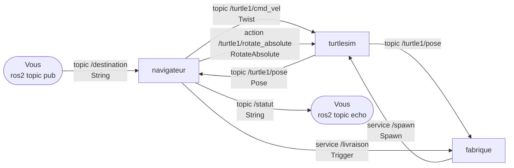

Une livraison se déroule en 4 étapes :

1. **Ordre.** Vous publiez un nom de lieu sur le topic `/destination`.
2. **Orientation.** Le `navigateur` demande à `turtlesim` de tourner la tortue vers le lieu. Il utilise pour cela une **action** : un ordre long, avec un suivi pendant l'exécution.
3. **Déplacement.** Le `navigateur` lit la position de la tortue sur `/turtle1/pose` et publie des vitesses sur `/turtle1/cmd_vel` jusqu'à l'arrivée. Ce sont des **topics**.
4. **Livraison.** À l'arrivée, le `navigateur` appelle le **service** `/livraison` de la `fabrique`. La fabrique appelle à son tour le service `/spawn` de `turtlesim`, qui fait apparaître une nouvelle tortue.

> **Rappel PowerShell** : chaque nouveau terminal doit être préparé avec les deux commandes ci-dessous (ROS 2, puis votre workspace). On les appellera « **préparer le terminal** ».
>
> ```powershell
> pixi shell                      # depuis le dossier ros2_ws
> cd tp_ws
> . .\install\local_setup.ps1     # attention au point et à l'espace au début
> ```

---

## Partie 1 — Workspace et package (15 min)

### 1.1 Explorer le workspace

Ouvrez un terminal PowerShell dans le dossier `ros2_ws`, puis :

```powershell
pixi shell
cd tp_ws
tree /F src
```

Vous devez obtenir :

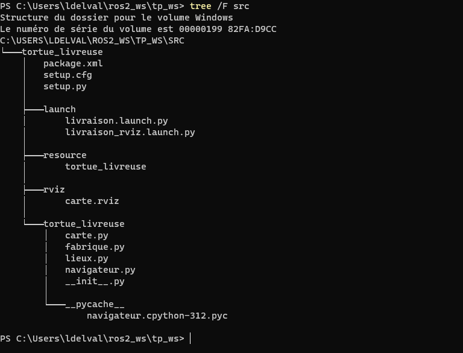

Le rôle de chaque fichier :

```
src
└── tortue_livreuse                  <- un PACKAGE
    ├── package.xml                  <- carte d'identité + dépendances
    ├── setup.py                     <- comment installer le package, liste des exécutables
    ├── setup.cfg
    ├── resource/tortue_livreuse
    ├── launch/
    │   ├── livraison.launch.py      <- lance l'application
    │   └── livraison_rviz.launch.py <- idem + carte + RViz (partie 6)
    ├── rviz/
    │   └── carte.rviz               <- configuration de l'affichage RViz
    └── tortue_livreuse/             <- le code Python
        ├── navigateur.py            <- NŒUD navigateur
        ├── fabrique.py              <- NŒUD fabrique
        ├── carte.py                 <- NŒUD carte (TF + affichage RViz)
        └── lieux.py                 <- carnet d'adresses
```

Ouvrez `package.xml` et `setup.py` dans VS Code.

- **Q1.** Dans `package.xml`, de quels autres packages `tortue_livreuse` dépend-il ?
- **Q2.** Dans `setup.py`, repérez la section `entry_points`. Quels exécutables le package fournit-il ?

### 1.2 Construire le workspace

Toujours dans `tp_ws` :

```powershell
colcon build
dir
```

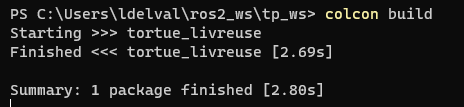

- **Q3.** Quels nouveaux dossiers sont apparus à côté de `src` ? Lequel contient ce qui sera réellement exécuté ?

### 1.3 Charger l'overlay

```powershell
ros2 pkg list | Select-String tortue      # rien : ROS 2 ne connaît pas encore votre package
. .\install\local_setup.ps1               # on charge l'overlay de tp_ws
ros2 pkg list | Select-String tortue      # il apparaît
ros2 pkg executables tortue_livreuse
```

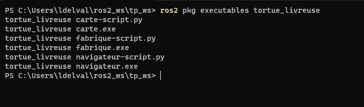

- **Q4.** Avec vos mots : à quoi sert `local_setup.ps1` ? Que se passe-t-il si on ouvre un nouveau terminal sans le relancer ?

---

## Partie 2 — Lancer l'application et observer les nœuds (15 min)

### 2.1 Lancer

**Terminal 1** (déjà préparé) :

```powershell
ros2 launch tortue_livreuse livraison.launch.py
```

La fenêtre turtlesim s'ouvre. Le `navigateur` affiche la liste des lieux connus. Laissez ce terminal ouvert.

### 2.2 Donner un premier ordre

**Terminal 2** : préparez le terminal, puis :

```powershell
ros2 topic pub --once /destination std_msgs/msg/String "{data: boulangerie}"
```

Observez la tortue et les messages du terminal 1. Essayez ensuite `parc`, puis `maison`, puis un lieu qui n'existe pas (`lune`).

| Après la livraison à la boulangerie | Après une 2e livraison |
|---|---|
| 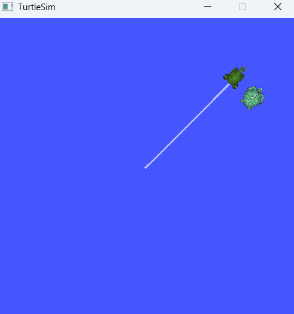 | 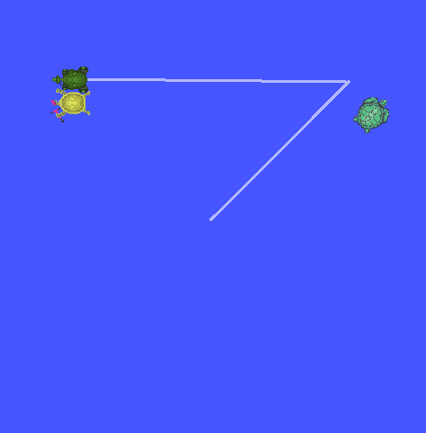 |

- **Q5.** Que se passe-t-il pour un lieu inconnu ? Et si vous envoyez un nouvel ordre pendant que la tortue roule ?

### 2.3 Les nœuds

```powershell
ros2 node list
ros2 node info /navigateur
```

- **Q6.** Combien de nœuds tournent ? Lequel ne vient pas de notre package ?
- **Q7.** Avec `ros2 node info /navigateur`, relevez ses *Subscribers*, *Publishers*, *Service Clients* et *Action Clients*. Retrouvez-les dans le schéma du scénario.

### 2.4 Le graphe

**Terminal 3** (préparé) :

```powershell
rqt_graph
```

Dans le menu déroulant en haut à gauche, choisissez **Nodes/Topics (all)** et décochez **Hide: Debug**.

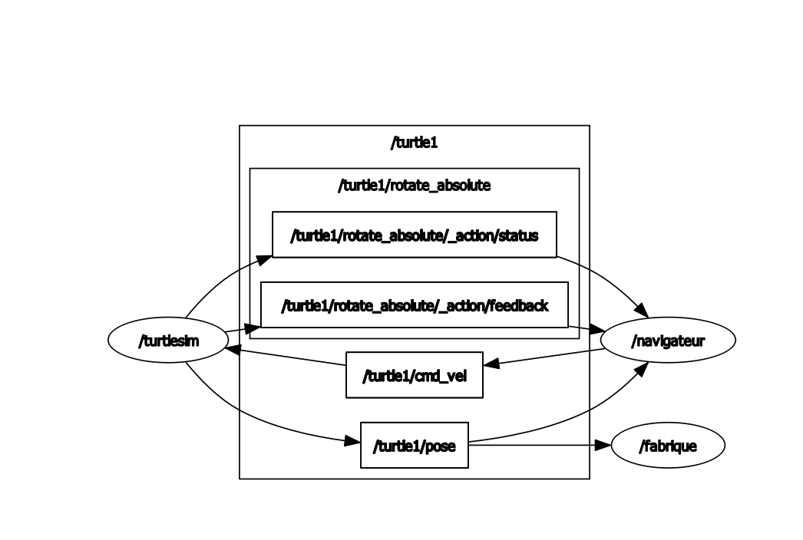

- **Q8.** Retrouvez les topics `/turtle1/pose` et `/turtle1/cmd_vel`. Qui publie, qui écoute ? Pourquoi `/destination` n'apparaît-il pas, alors que le `navigateur` y est abonné ? (Indice : qui publie dessus ?)
  *Remarque :* `rqt_graph` affiche les **topics**, pas les services. Les actions apparaissent seulement à travers leurs topics internes (`.../_action/feedback` et `.../_action/status`).

---

## Partie 3 — Topics et messages (15 min)

### 3.1 Lister et inspecter les topics

```powershell
ros2 topic list
ros2 topic info /turtle1/pose
ros2 topic hz /turtle1/pose            # Ctrl+C pour arrêter
```

- **Q9.** Quel est le **type de message** de `/turtle1/pose` ? À quelle fréquence est-il publié ?

### 3.2 Lire le contenu d'un message

```powershell
ros2 interface show turtlesim/msg/Pose
ros2 interface show geometry_msgs/msg/Twist
ros2 interface show std_msgs/msg/String
```

- **Q10.** Quels champs contient un message `Pose` ? Un message `Twist` ?
- **Q11.** Dans `navigateur.py`, fonction `conduire`, quels champs du `Twist` sont remplis ? Pourquoi les autres ne servent-ils à rien pour une tortue 2D ?

### 3.3 Écouter les topics pendant une livraison

Dans le terminal 3 (fermez `rqt_graph` si besoin) :

```powershell
ros2 topic echo /statut
```

Dans le terminal 2, envoyez une livraison vers `ecole`. Recommencez ensuite avec `ros2 topic echo /turtle1/cmd_vel` à la place de `/statut`.

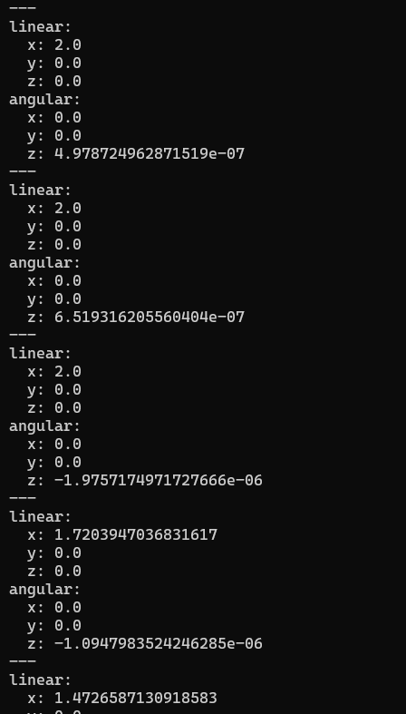

- **Q12.** Que voit-on sur `/turtle1/cmd_vel` pendant le trajet ? Et à l'arrivée ?

### 3.4 Publier soi-même

Pilotez la tortue à la main, à la place du navigateur :

```powershell
ros2 topic pub --rate 1 /turtle1/cmd_vel geometry_msgs/msg/Twist "{linear: {x: 1.0}, angular: {z: 1.0}}"
```

Arrêtez avec Ctrl+C.

- **Q13.** Que fait la tortue ? Expliquez le rôle de `linear.x` et `angular.z`.

---

## Partie 4 — Services (15 min)

Un **service** fonctionne comme une question-réponse : un client envoie une **requête**, le serveur la traite et renvoie **une réponse**.

### 4.1 Lister les services

```powershell
ros2 service list
ros2 service type /livraison
ros2 service type /spawn
ros2 interface show std_srvs/srv/Trigger
ros2 interface show turtlesim/srv/Spawn
```

- **Q14.** Dans un fichier `.srv`, que signifie la ligne `---` ?
- **Q15.** La requête de `Trigger` contient-elle des champs ? Que contient sa réponse ?

### 4.2 Appeler un service à la main

Livrez un colis sans déplacer la tortue :

```powershell
ros2 service call /livraison std_srvs/srv/Trigger
```

Puis faites apparaître votre propre tortue directement avec turtlesim :

```powershell
ros2 service call /spawn turtlesim/srv/Spawn "{x: 1.0, y: 5.0, theta: 0.0, name: 'ma_tortue'}"
```

- **Q16.** Quelle réponse obtenez-vous pour chaque appel ? Que se passe-t-il si vous relancez `/spawn` avec le même `name` ? (Regardez le terminal 1.)
- **Q17.** Dans `fabrique.py`, la fonction `livrer` est à la fois **serveur** d'un service et **client** d'un autre. Lesquels ?

### 4.3 Autres services de turtlesim

```powershell
ros2 service call /turtle1/set_pen turtlesim/srv/SetPen "{r: 255, g: 0, b: 0, width: 5, 'off': 0}"
ros2 service call /kill turtlesim/srv/Kill "{name: 'ma_tortue'}"
```

Faites ensuite une livraison : le trait de la tortue est maintenant rouge et épais.

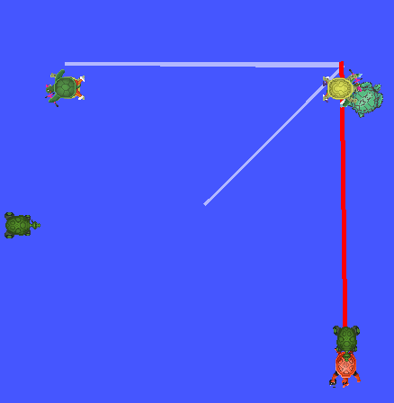

---

## Partie 5 — Actions (15 min)

Une **action** sert pour une tâche longue. Le client envoie un **but** (*goal*), reçoit des **retours** pendant l'exécution (*feedback*), puis un **résultat** (*result*). Le but peut aussi être annulé en cours de route.

### 5.1 Inspecter l'action de turtlesim

```powershell
ros2 action list
ros2 action info /turtle1/rotate_absolute
ros2 interface show turtlesim/action/RotateAbsolute
```

- **Q18.** Un fichier `.action` a **deux** séparateurs `---`. À quoi correspond chacune des trois parties ?
- **Q19.** Qui est le **serveur** de cette action ? Qui en est **client** ?

### 5.2 Envoyer un but à la main

```powershell
ros2 action send_goal /turtle1/rotate_absolute turtlesim/action/RotateAbsolute "{theta: 3.14}" --feedback
```

Le but est accepté, puis les feedbacks arrivent pendant la rotation :

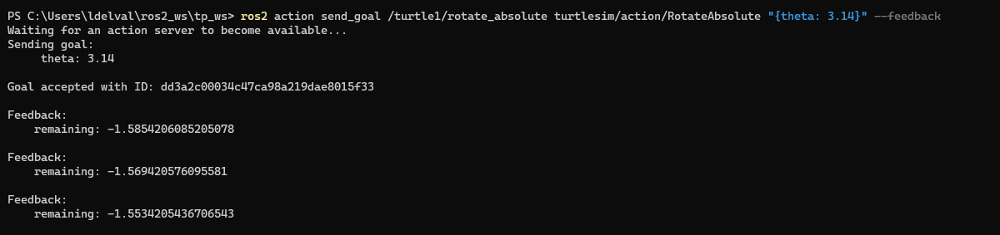

À la fin, le serveur renvoie le résultat :

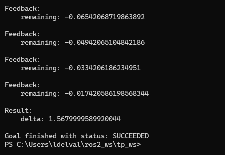

- **Q20.** Que représente le feedback `remaining` ? Que vaut le résultat `delta` à la fin ?

### 5.3 L'action dans le code

Dans `navigateur.py`, repérez les fonctions `orienter_vers`, `retour_rotation`, `but_accepte` et `rotation_terminee`.

- **Q21.** Associez chaque fonction à une étape de l'action : envoi du but, acceptation, feedback, résultat.
- **Q22.** Pourquoi utiliser une **action** pour tourner, plutôt qu'un **service** ? Pensez à la durée de la rotation et à ce que voit le client pendant ce temps.

---

## Partie 6 — Visualiser et piloter dans RViz (20 min)

**RViz** est l'outil de visualisation 3D de ROS 2. Il ne simule rien : c'est un **abonné** qui dessine ce qu'il reçoit sur des topics. Pour savoir *où* dessiner chaque chose, il utilise **TF**, le système de repères de ROS 2.

Un 4e nœud, `carte`, fait le lien entre turtlesim et RViz :

- il convertit `/turtle1/pose` en une **transformation TF** `world` → `turtle1` ;
- il publie le trajet parcouru (`/trajet`) et un dessin de la tortue (`/tortue_marker`) ;
- il crée des **marqueurs interactifs** : chaque lieu est un bouton cliquable, et un drapeau rouge peut être déplacé à la souris.

### 6.1 Lancer la version RViz

Arrêtez l'application (Ctrl+C dans le terminal 1), puis :

```powershell
ros2 launch tortue_livreuse livraison_rviz.launch.py
```

Deux fenêtres s'ouvrent : turtlesim et RViz. Dans RViz, la grille de 11 × 11 cases correspond à la fenêtre turtlesim. Les disques bleus sont les lieux, et la flèche verte est la tortue. Le trait orange montre le trajet parcouru, et le trait jaune relie le repère `world` (le coin en bas à gauche) au repère `turtle1`.

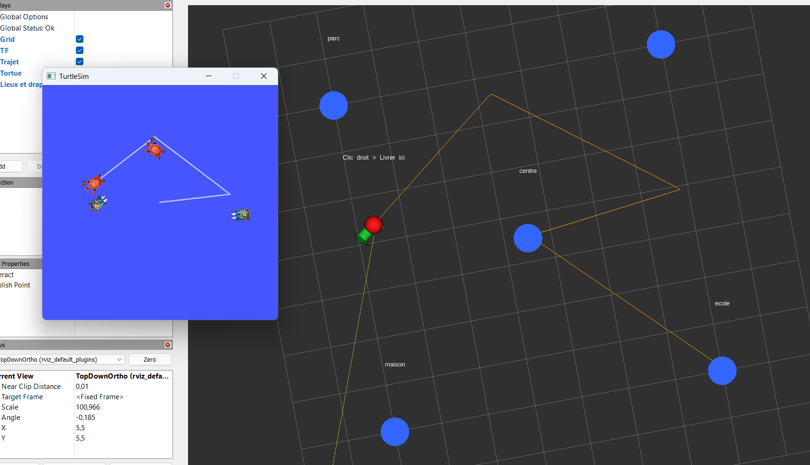

### 6.2 Les repères TF

Dans un autre terminal :

```powershell
ros2 run tf2_ros tf2_echo world turtle1       # Ctrl+C pour arrêter
```

Envoyez une livraison et observez les valeurs.

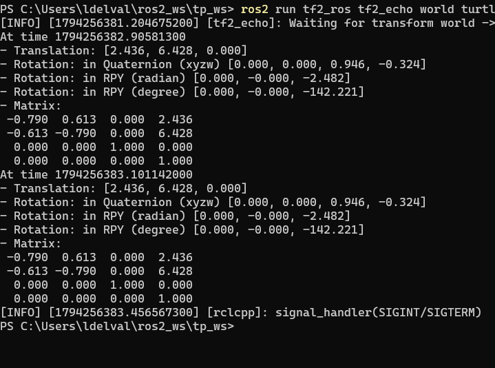

- **Q23.** Quel est le repère **parent** et le repère **enfant** ? Que représentent `Translation` et `Rotation` ?
- **Q24.** Dans RViz, panneau *Displays*, réglez **Fixed Frame** sur `turtle1` au lieu de `world`. Que se passe-t-il pendant un déplacement ? Remettez ensuite `world`.
- **Q25.** Dans `carte.py`, la flèche verte est publiée dans le repère `turtle1` et non dans `world`. Pourquoi suit-elle quand même la tortue ?

### 6.3 Piloter à la souris

Dans un terminal, lancez `ros2 topic echo /destination`, puis, dans RViz, avec l'outil **Interact** (barre du haut) :

1. **Cliquez sur un lieu** (disque bleu) : la tortue y va.
2. **Glissez le drapeau rouge** n'importe où, puis faites un **clic droit** dessus et choisissez **Livrer ici**.
3. Choisissez l'outil **Publish Point** dans la barre du haut, puis cliquez sur la grille.

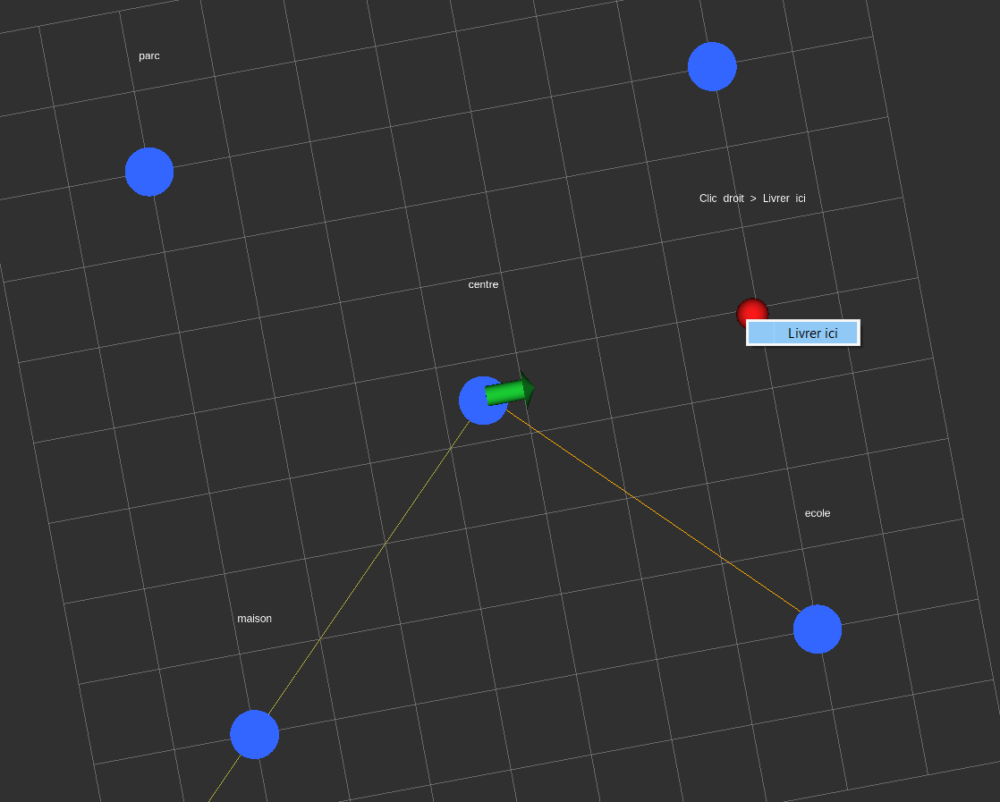

- **Q26.** Que voit-on sur `/destination` quand on clique sur un lieu ? Pour le drapeau, les messages partent sur un autre topic : lequel, et de quel type ? (Utilisez `ros2 node info /carte`.)
- **Q27.** Le `navigateur` n'a pas été modifié pour fonctionner avec la souris. Comment est-ce possible ? Qu'est-ce que cela montre sur l'intérêt des topics ?

### 6.4 RViz n'est qu'un abonné

- Dans le panneau *Displays*, décochez puis recochez `Trajet`, `Tortue` et `TF`.
- Cliquez sur **Add** > onglet **By topic** : la liste montre tous les topics que RViz sait afficher.

- **Q28.** Fermez la fenêtre turtlesim. Que devient l'affichage de la tortue dans RViz ? Expliquez avec la chaîne turtlesim → `/turtle1/pose` → `carte` → TF → RViz.

---

## Partie 7 — Modifier l'application (20 min)

Les zones que vous pouvez modifier sont repérées dans le code par `>>> MODIFIABLE`.

> **Cycle de modification** : modifier le fichier, puis `colcon build` (dans `tp_ws`), puis relancer l'application (Ctrl+C dans le terminal 1, puis `ros2 launch ...`).

### 7.1 Ajouter un lieu

Dans `tortue_livreuse/lieux.py`, ajoutez un lieu `piscine` en `(3.0, 7.0)`. Puis :

1. Testez **sans reconstruire** : relancez l'application et envoyez `piscine`.
2. Faites `colcon build`, relancez la version RViz, et réessayez.

- **Q29.** Pourquoi la modification n'est-elle pas prise en compte avant le `colcon build` ? (Pensez au rôle du dossier `install/`.)
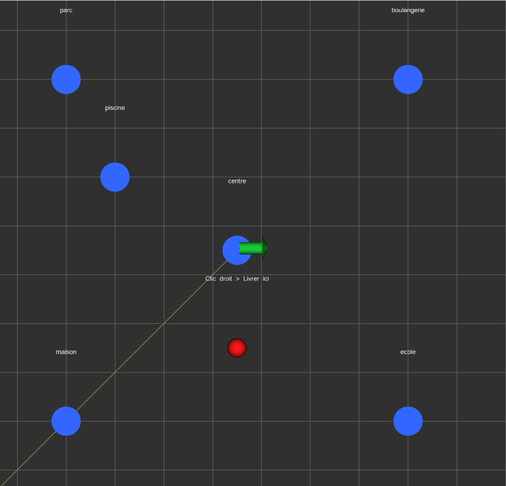

- **Q30.** La piscine apparaît aussi dans RViz, alors que `carte.py` n'a pas été modifié. Pourquoi ?

### 7.2 Changer un paramètre à chaud

Le `navigateur` a un **paramètre** `vitesse`. Pendant que l'application tourne :

```powershell
ros2 param list /navigateur
ros2 param get /navigateur vitesse
ros2 param set /navigateur vitesse 5.0
```

Envoyez une livraison et comparez la vitesse.

- **Q31.** Ici, pas besoin de reconstruire ni de relancer. Quelle différence avec la modification de `lieux.py` ?
- **Q32.** Dans `launch/livraison.launch.py`, changez la valeur initiale de `vitesse`. Faut-il reconstruire pour que ce changement soit pris en compte ?

### 7.3 Personnaliser la fabrique et la carte

Dans `fabrique.py`, modifiez :

- `PREFIXE` : par exemple `'pizza'` ;
- `DECALAGE` : par exemple `(0.6, 0.0)`, pour déposer le colis à droite de la tortue.

Dans `carte.py`, changez `COULEUR_LIEUX`, par exemple `(1.0, 0.8, 0.0)` pour du jaune.

Reconstruisez, relancez et vérifiez avec `ros2 topic list` : chaque nouvelle tortue a ses propres topics (`/pizza_1/pose`…).

### 7.4 La précision d'arrivée

Dans `navigateur.py`, passez `TOLERANCE` de `0.1` à `1.0`. Reconstruisez et relancez.

- **Q33.** Qu'observez-vous à l'arrivée ? Quel compromis cette valeur règle-t-elle ? (Le trajet orange dans RViz aide à le voir.)

### 7.5 Bonus

- **Tournée** : tracez une forme (carré, maison…) en enchaînant les ordres de livraison. Ajoutez au besoin de nouveaux lieux.
- **rqt** : lancez `rqt`, puis ouvrez les plugins *Topics > Message Publisher* et *Services > Service Caller*. Donnez des ordres et livrez des colis sans la ligne de commande.
- **Dessin** : avant chaque livraison, changez la couleur du crayon avec `/turtle1/set_pen`.

---

## Partie 8 — Bilan (5 min)

Complétez le tableau avec un exemple tiré du TP pour chaque notion :

| Notion | En une phrase | Exemple dans le TP |
|---|---|---|
| Workspace | | |
| Package | | |
| Nœud | | |
| Topic | | |
| Message | | |
| Service | | |
| Action | | |
| TF | | |

- **Q34.** Pour chacun des besoins suivants, faut-il plutôt un topic, un service ou une action ?
  - envoyer la position d'un robot 50 fois par seconde ;
  - demander à un bras robotique de saisir une pièce (plusieurs secondes) ;
  - demander la température actuelle d'un capteur, une seule fois.

---

## Aide-mémoire

| Commande | Rôle |
|---|---|
| `colcon build` | Construire le workspace (depuis `tp_ws`) |
| `. .\install\local_setup.ps1` | Charger l'overlay dans le terminal |
| `ros2 launch tortue_livreuse livraison.launch.py` | Lancer l'application |
| `ros2 launch tortue_livreuse livraison_rviz.launch.py` | Lancer l'application avec RViz |
| `ros2 run tf2_ros tf2_echo world turtle1` | Afficher une transformation TF |
| `ros2 run <package> <executable>` | Lancer un seul nœud |
| `ros2 node list` / `info` | Nœuds |
| `ros2 topic list` / `info` / `echo` / `hz` / `pub` | Topics |
| `ros2 service list` / `type` / `call` | Services |
| `ros2 action list` / `info` / `send_goal` | Actions |
| `ros2 interface show <type>` | Contenu d'un message, d'un service ou d'une action |
| `ros2 param list` / `get` / `set` | Paramètres |
| `rqt_graph`, `rqt` | Outils graphiques |

## Dépannage

| Problème | Solution |
|---|---|
| `ros2` n'est pas reconnu | Le terminal n'est pas dans `pixi shell`. Vérifiez aussi que le chemin du dossier ne contient ni accent ni espace. |
| `Package 'tortue_livreuse' not found` | Overlay non chargé : `. .\install\local_setup.ps1` depuis `tp_ws`. |
| Ma modification n'a aucun effet | Avez-vous fait `colcon build` **et** relancé l'application ? |
| Je vois les nœuds de mes voisins | `ROS_LOCALHOST_ONLY` doit valoir `1` : `echo $env:ROS_LOCALHOST_ONLY`. Rouvrez le terminal avec `pixi shell`. |
| RViz : « Frame [world] does not exist », rien ne s'affiche | Le nœud `carte` ne tourne pas : utilisez `livraison_rviz.launch.py`. Vérifiez que *Fixed Frame* vaut `world`. |
| RViz : cliquer sur un lieu ne fait rien | Sélectionnez l'outil **Interact** dans la barre du haut. |
| La tortue tape un mur | Gardez les coordonnées des lieux entre 1 et 10. |
| Tout semble bloqué | Ctrl+C dans tous les terminaux, puis `ros2 daemon stop` et relancez. |
